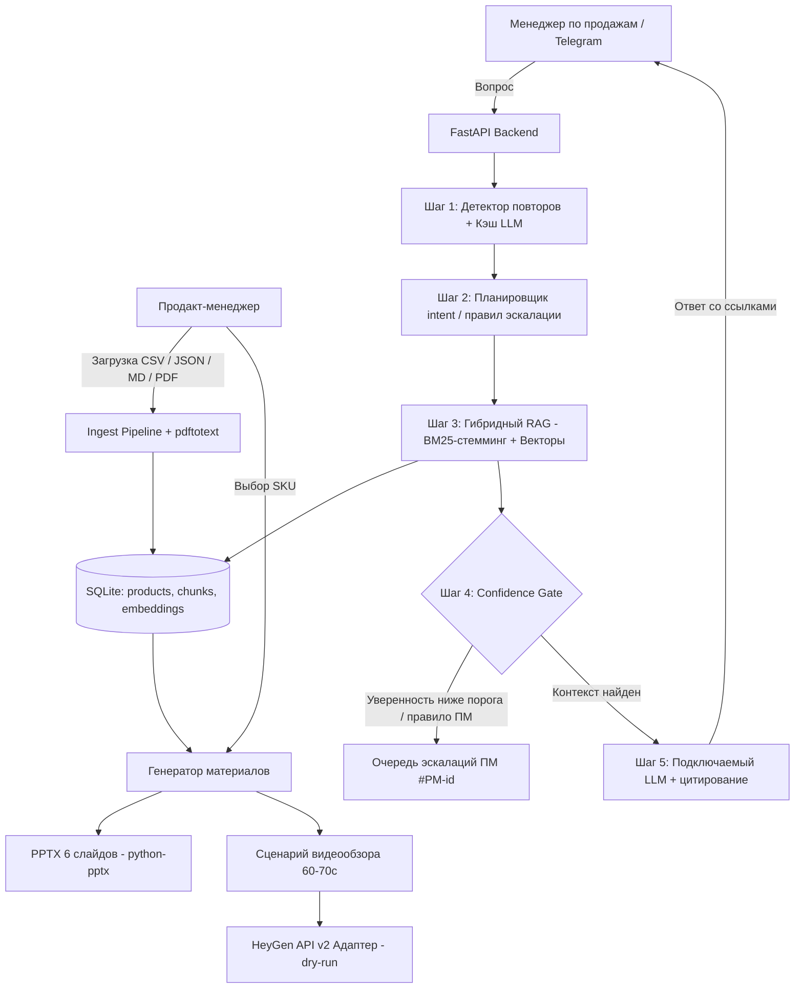

# ИИ-помощник продакт-менеджера интернет-магазина (трек «Цифровой аватар»)

Базовый рабочий прототип к хакатону **«ИИкузница»** (ПАО «Софтлайн», спринт 26.11–28.11.2026).

> **Обновлено 26.11.2026 (спринт), по материалам кик-оффа.** Реальная задача заказчика — **аналитический ИИ-помощник продукт-менеджера**:
> объединить данные Яндекс Метрики, продажи, релизы, бэклог, пользовательские исследования и конкурентный анализ, перекрёстно проверить сигнал,
> сформулировать гипотезы и критерии **до** разработки, отправить задачу в бэклог с тегом **«сгенерирована ИИ-помощником»**, а **после** релиза
> измерить эффект и решить: закрыть задачу или пересмотреть гипотезу. Это основной режим (`/`). Прежний режим «ответы отделу продаж» по демо-каталогу
> (наработка до спринта) оставлен на `/sales`.
>
> **Данные.** Решение использует **обезличенный тестовый датасет, предоставленный организаторами ИИкузницы** (v17), транскрибации интервью и
> конкурентное исследование store.softline.ru. По правилам датасета **данные не публикуются** — в репозитории их нет: они кладутся в `private-data/`
> (в `.gitignore` и `.dockerignore`) или в каталог `PM_DATA_DIR`. Стенд с данными закрыт паролем.

## 0. ИИ-помощник ПМ: как работает (спринт 26.11–28.11)

```
Яндекс Метрика (Reporting API / тестовые агрегаты) ─┐
Продажи (индекс заказов по семействам)  ─────────────┤
Релизы, Бэклог, Справочник метрик  ──────────────────┼─► детерминированный движок (Python) ─► отчёт по сигналу ─► LLM (Cloud.ru, GigaChat) пишет текст по фактам
Интервью и исследования (xlsx, дообучение загрузкой) ─┤        │                                     │
Конкурентный анализ (xlsx + pptx)  ───────────────────┘        ▼                                     ▼
                                                   задачи в бэклог с тегом, предложения        письмо/сообщение ПМ (dry-run по умолчанию)
                                                   приоритета (ПМ принимает/отклоняет)         замер эффекта после релиза → закрыть / пересмотреть
```

1. **Сигнал** (`app/pm/analysis.py`): ищет устойчивое отклонение индекса заказов (по скользящему 4 нед, а не по отдельным неделям), исключает переходную неделю релиза, помечает неполную последнюю неделю.
2. **Контрольная группа**: то же окно для другого семейства (diff-in-diff) — отделяет эффект релиза семейства от общемагазинных событий.
3. **Релизы в окне**: главный кандидат / фактор / отсеян — с объяснением (тип релиза, затронутые метрики, реакция контроля).
4. **Воронка Метрики**: метрики воронки задаются конфигом; если метрика не собирается — «не измеряется», а не «ноль».
5. **Бэклог**: связанные задачи (выпущенные в релизе-кандидате, открытые по метрикам воронки) и предложения по приоритету.
6. **Исследования и конкуренты**: цитаты интервью про сложности покупки/подбора, ценовые факты конкурентов; если подтверждения нет — так и пишет.
7. **Перекрёстная проверка**: «подтверждают N из M источников», гипотезы с проверками и критериями, критерий успеха и правило закрытия.
8. **После релиза** (`app/pm/effect.py`): 4 недели до/после, контроль, цель = база минус допуск; вердикт «закрыть задачу» / «пересмотреть гипотезу» / «ждём данных». Для демо можно ввести будущие недели — они помечаются как СИМУЛЯЦИЯ.
9. **Разрывы данных** (список в локальном конфиге) выводятся в каждом отчёте; неполная последняя неделя определяется автоматически.

**Настраиваемость:** пороги, окна, тег задачи и тексты по умолчанию — в `config/pm_signals.json`. Всё, что выведено из материалов организаторов (семейства и контрольные группы, метрики воронки, известные разрывы данных, формулировки гипотез, примеры вопросов), лежит в `pm_signals.local.json` рядом с данными (`PM_DATA_DIR`, вне git) и подмешивается при запуске; меняются без кода через `PUT /api/pm/config` (сохраняются как override).
**Яндекс Метрика:** `app/pm/metrika.py` — Reporting API (`METRIKA_TOKEN`, `METRIKA_COUNTER_ID`, маппинг metric_id → запрос в конфиге); без токена используются тестовые агрегаты из датасета (разрешено организаторами).
**Закрытый контур / дообучение:** новые интервью и исследования (xlsx/md/txt/csv) загружаются через `POST /api/pm/research/upload` или кладутся в `PM_DATA_DIR` → сразу участвуют в перекрёстной проверке. LLM — Cloud.ru Foundation Models (РФ), данные не используются для обучения модели.

### API (основное)
| Метод | Что делает |
|---|---|
| `GET /api/pm/scan` | проактивный скан всех семейств + пост-релизный мониторинг |
| `GET /api/pm/signal/{family}` | полный отчёт по сигналу |
| `POST /api/pm/ask` | вопрос агенту на естественном языке |
| `POST /api/pm/apply/{family}` | задача в бэклог с тегом + предложения приоритета + письмо ПМ |
| `GET /api/pm/backlog`, `/backlog/ranked`, `/backlog.csv` | бэклог, приоритизация, экспорт для Jira |
| `POST /api/pm/changes/{id}?approve=true` | ПМ принимает/отклоняет предложение агента |
| `POST /api/pm/effect` | замер эффекта после релиза/исправления |
| `GET/PUT/DELETE /api/pm/config` | настраиваемые параметры |
| `GET /api/pm/metrika/status`, `POST /api/pm/metrika/sync` | Яндекс Метрика |

### Проверка
```bash
pip install -r requirements.txt
mkdir -p private-data   # положить сюда материалы задачи с Google Drive организаторов (xlsx, pptx, zip)
python tests/smoke_pm.py --local                      # эталонный кейс; ожидаемые значения — в private-data/expected.local.json (вне git); нет файла — SKIP
./run.sh                                               # http://localhost:8091
python tests/smoke_pm.py --url http://localhost:8091 --llm   # стенд по HTTP, с ответом LLM
```

---

## 1. Бизнес-проблема (по брифу задачи)

Продакт-менеджеры интернет-магазина тратят значительную часть времени на повторяющиеся коммуникации и подготовку материалов для отдела продаж:
- презентации новых товаров для менеджеров по продажам и обучение команды;
- ответы на типовые вопросы о характеристиках, комплектации, доставке и условиях;
- запись видеообзоров карточек товаров;
- коммуникации с вендорами и клиентами.

По цифрам брифа:
- подготовка 1 презентации или видеообзора занимает **1–3 часа**, при потребности в **10–20 материалах в месяц** это **20–60 часов в месяц** на одного продакт-менеджера;
- до **50% вопросов** от менеджеров и клиентов повторяются;
- следствие: продакт-менеджер не успевает заниматься развитием продукта, а отдел продаж получает ответы с задержкой.

---

## 2. Решение

Единый агентный сервис для отдела продаж и продакт-менеджера:
1. **Единая база знаний с ингестом (CSV / JSON / MD / TXT / PDF):** нормализует карточки товаров и регламенты в единый индекс с обязательным цитированием источника (`[Источник: SKU / файл]`).
2. **Многошаговый ИИ-агент для менеджеров по продажам (Web UI + Telegram-адаптер):**
   - отвечает на типовые вопросы по характеристикам и условиям;
   - сравнивает товары бок о бок по спецификациям и цене;
   - выявляет повторяющиеся вопросы (нормализация + кластеризация) и кэширует ответы LLM;
   - при нехватке уверенности или по бизнес-правилам (нет в наличии без даты поставки, оптовая скидка 10+ шт., тендер 44-ФЗ/223-ФЗ) отвечает **«Не знаю — передаю продакт-менеджеру»** и создаёт тикет в очереди ПМ (`#PM-...`).
3. **Генератор материалов (PPTX + сценарий + адаптер цифрового аватара):**
   - из любой карточки товара генерирует 6-слайдовую презентацию для отдела продаж (`.pptx` через `python-pptx`, включая сравнение с ближайшим аналогом из каталога и отработку возражений);
   - генерирует сценарий видеообзора (5 сцен с таймкодами) и готовый payload для **HeyGen API v2** (`POST /v2/video/generate`) в режиме **`dry_run=true` по умолчанию** (валидный JSON-запрос формируется и сохраняется без списания кредитов).

---

## 3. Архитектура



### Подключаемые провайдеры LLM (включая российский контур 152-ФЗ)
Слой `app/llm_client.py` поддерживает переключение через переменные окружения (без хардкода ключей):
- `cloudru` — **Cloud.ru Foundation Models** (`https://foundation-models.api.cloud.ru/v1`), по умолчанию `GigaChat/GigaChat-3-Pro` + запасная `ai-sage/GigaChat3-10B-A1.8B`, эмбеддинги `ai-sage/Giga-Embeddings-instruct-480M` (**российский хостинг**, проверен в работе).
  - **Open Weights (Apache 2.0):** `LLM_MODEL=openai/gpt-oss-120b`, `LLM_FALLBACK_MODEL=openai/gpt-oss-20b`, `LLM_PRICE_IN_RUB_1M=15.86`, `LLM_PRICE_OUT_RUB_1M=61`, `LLM_REASONING_EFFORT=low`, `LLM_MAX_TOKENS_EXTRA=600` (у рассуждающей модели токены рассуждения входят в лимит ответа). Замена только переменными окружения, код не меняется.
- `gigachat` — прямой Sberbank GigaChat API (OAuth + `LLM_CA_BUNDLE`).
- `yandex` — YandexGPT (`LLM_FOLDER_ID` + `Api-Key`).
- `minimax` / `openrouter` / `openai` — любой OpenAI-compatible шлюз.
- `mock` — детерминированный локальный режим без ключа (возвращает извлечённые факты с цитатами).

---

## 4. Расчётная формула экономии времени и экономика запроса

> **Оговорка:** Это **расчётная оценка на основе цифр из брифа задачи**, а не замер на реальном магазине заказчика.

### Оценка экономии времени продакт-менеджера
Пусть:
- $N_{mat} \in [10; 20]$ — материалов в месяц (презентации + видеообзоры), $t_{mat} \in [1; 3]$ ч — ручная подготовка 1 материала (по брифу: $T_{mat} = N_{mat} \times t_{mat} = 20\text{–}60$ ч/мес).
- При автоматической генерации черновика PPTX и видеосценария время ПМ сводится к проверке/правке фактов ($t_{review} \approx 0.25$ ч на материал, экономия $\approx 75\text{–}90\%$ времени на черновике):
  $$T_{saved\_mat} = N_{mat} \times (t_{mat} - t_{review})$$
  На диапазоне брифа: от $10 \times (1 - 0.25) = 7.5$ ч/мес (нижняя граница) до $20 \times (3 - 0.25) = 55$ ч/мес (верхняя граница).
- По коммуникациям: пусть $Q_{mo}$ — вопросов от менеджеров в месяц, доля типовых/повторяющихся $r_{rep} \le 0.50$ (по брифу «до 50% вопросов повторяются»), среднее время отвлечения ПМ на 1 ответ $t_q$ (напр. 5 мин = $1/12$ ч). Если агент закрывает долю $\alpha$ типовых вопросов без участия ПМ:
  $$T_{saved\_qa} = Q_{mo} \times r_{rep} \times \alpha \times t_q$$
  Например, при $Q_{mo} = 200$ вопросов/мес, $r_{rep} = 0.50$, $\alpha = 0.85$, $t_q = 5$ мин: $200 \times 0.50 \times 0.85 \times (5/60) \approx 7.1$ ч/мес дополнительно.

### Экономика эксплуатации (стоимость 1 запроса по факту замеров в `tests-log.md`)
По реальным замерам на провайдере **Cloud.ru FM (`GigaChat/GigaChat-3-Pro`, тариф 96 ₽/1М вход и 289 ₽/1М выход)** в `tests-log.md`:
- Средний объём контекстного ответа без кэша (Q1–Q6): **~2 686 входных + 134 выходных токенов** $\rightarrow$ **0.296 ₽ за уникальный запрос** (~0.22–0.33 ₽).
- Повторный запрос через **LLM-кэш** (Q7) или ранняя эскалация по Confidence Gate / правилам (Q8–Q10): **0 токенов = 0.00 ₽**.
- При доле повторов 50% и эскалаций ~15% эффективная средняя стоимость 1 обращения падает до **~0.10–0.18 ₽** (в нашем тесте из 11 запросов: **0.183 ₽/запрос**, суммарно **2.01 ₽** за весь прогон).
- Генерация 1 PPTX-презентации: **0 ₽** (локально `python-pptx`); генерация 1 видеосценария + HeyGen payload (dry-run): **~0.33 ₽** за LLM + тариф HeyGen только при реальном рендере видео.

---

## 5. Быстрый запуск и тестирование

```bash
git clone https://github.com/oqoxucufawo66-spec/iikuznitsa-pm-assistant.git
cd iikuznitsa-pm-assistant
python3 -m venv .venv && .venv/bin/pip install -r requirements.txt
cp .env.example .env   # впишите свой ключ LLM; без ключа работает mock-режим
./run.sh               # FastAPI + веб-интерфейс на http://127.0.0.1:8091
```

Сквозной автотест (поднимает локальный стенд на :8099, прогоняет вопросы, PPTX, видеосценарий + HeyGen dry-run, Telegram-вебхук и пишет `tests-log.md`):
```bash
.venv/bin/python tests/run_e2e.py
```

Ключи и токены в репозиторий не попадают: `.env` и любые `.env.*` (кроме `.env.example`) в `.gitignore`, история проверена `gitleaks`.

---

## 6. Наработки до спринта и сторонние библиотеки (п. 4.8 Положения)

### Наработки до спринта
- **Базовый прототип сделан до начала спринта (до 26.11.2026)** — это первый коммит репозитория («База: прототип…»). В него входят: каркас FastAPI, гибридный RAG (BM25 + эмбеддинги), агент с порогом уверенности и эскалацией к ПМ, генератор PPTX, адаптер HeyGen v2 в режиме dry-run, мультипровайдерный LLM-клиент, демо-каталог «ТехноВитрина» (20 товаров, помечены «ДЕМО-ДАННЫЕ»).
- **Всё, что сделано в спринте (26.11–28.11.2026), — отдельными коммитами после базового**; их видно в истории `git log`.
- Демо-данные режима `/sales` синтетические и созданы автором.
- **В спринте (с 26.11) написан весь аналитический контур ПМ** (`app/pm/*`, `app/static/pm.html`, `config/pm_signals.json`, `tests/smoke_pm.py`) под материалы задачи; из базы переиспользованы LLM-клиент, учёт токенов и лексический поиск.
- Паттерн OpenAI-совместимого LLM-клиента и очистки блоков `<think>` — общеизвестный открытый подход; код написан автором.

### Сторонние библиотеки (из `requirements.txt`)
| Библиотека | Лицензия | Зачем |
|---|---|---|
| FastAPI | MIT | HTTP API и веб-интерфейс |
| Uvicorn | BSD-3 | ASGI-сервер |
| HTTPX | BSD-3 | запросы к LLM, HeyGen, Telegram |
| Pydantic | MIT | схемы запросов и настроек |
| python-multipart | Apache-2.0 | загрузка файлов базы знаний |
| python-pptx | MIT | генерация презентаций |
| NumPy | BSD-3 | векторный поиск (косинусная близость) |
| WeasyPrint | BSD-3 | генерация PDF демо-документа |
| pytest | MIT | тесты |
| openpyxl | MIT | чтение xlsx материалов задачи (датасет, интервью, конкурентный анализ) |

Системные и внешние компоненты: SQLite (встроена в Python), poppler-utils (`pdftotext`, извлечение текста из PDF), внешние API — Cloud.ru Foundation Models (GigaChat-3-Pro, Giga-Embeddings), HeyGen API v2 (по умолчанию dry-run, кредиты не тратятся), Telegram Bot API (опционально).

---

## 7. Дорожная карта на спринт (26.11–28.11.2026)
- **26.11 10:30 МСК (Кик-офф):** уточнить портрет пользователя (продакт-менеджер vs менеджер продаж), форматы входных карточек и ожидания по треку «Цифровой аватар» (какой аватар-провайдер/озвучка предпочтительны, есть ли партнёрские кредиты).
- **26.11 день:** подключить реальный/предоставленный датасет заказчика, добавить при необходимости генерацию голосовой дорожки (`edge-tts` / локальный TTS поверх слайдов как бесплатный fallback к HeyGen) и автотест качества RAG на данных заказчика.
- **27.11 10:30 МСК (Q&A с заказчиком):** уточнить точные триггеры эскалации ПМ, каналы доставки (Telegram / Bitrix24 / веб-портал), требования к шаблону PPTX и брендированию.
- **27.11 вечер – 28.11 до 10:00 МСК (Сдача):** выложить публичный стенд, залить чистый публичный Git-репозиторий с историей коммитов, заполнить шаблон расчёта стоимости, записать 3-минутное демо-видео одним дублем (п. 4.5(1)) и отправить в личном кабинете до 28.11 10:00 МСК.
